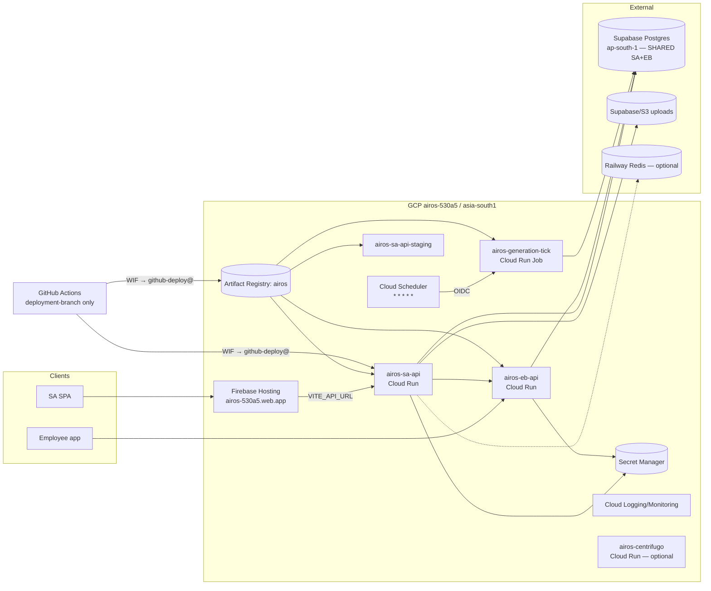

# Google Cloud Environment Audit — AiROS (Pre-Deployment Cleanup Prep)

**Audit date:** 2026-11-02 · **Audited by:** gcloud CLI inspection (read-only)
**Auditor account:** `baljyotskhokhar@gmail.com` (ADC user credentials)
**Target branch policy:** `deployment-branch` is the only permitted branch for deployment changes.
**No resources were created, modified, enabled, disabled or deleted.**

**Labels:** `VERIFIED` = observed via CLI/config · `INFERRED` = strong evidence · `UNKNOWN` = not observable.

---

## PART A — Git state

| Check | Result | Evidence |
|---|---|---|
| Current branch | `development-branch` | `git branch --show-current` |
| Working tree | **72 files modified/untracked — dirty** (all WIP: employee analysis, logs view, landing redesign, audit docs) | `git status --short` |
| `deployment-branch` exists? | **NO — neither local nor remote** | `git rev-parse --verify` fails on both |
| Created from `main`? | N/A — branch does not exist yet | — |
| Latest commits | `main` = `development-branch` = `origin/main` = `origin/development-branch` = **`c1e21e3`** (2026-10-15) | `git log -1`, `git rev-parse` |
| Divergence main↔dev | `0 ahead / 0 behind` — identical | `git rev-list --left-right --count` |
| Unpushed commits on dev | None — branch pushed earlier today, tracking `origin/development-branch` | `git log origin/development-branch..development-branch` empty |
| Uncommitted changes on dev | **Yes — all current work is uncommitted working-tree state**, including this repo's untracked GCP migration docs | `git status` |

**Conclusion (VERIFIED):** Isolation to `deployment-branch` is achievable but **the branch must still be created** — and per policy it should be cut from `main` (which currently equals `development-branch` anyway). The dirty working tree belongs to `development-branch`; nothing should be committed to `deployment-branch` except deployment artifacts.

⚠️ **Important context:** the deployed Cloud Run images (see Part B) were built on/after 2026-10-26 — **11+ days after HEAD `c1e21e3`** — while this repo has no commits since 2026-10-15. Whatever was deployed to GCP cannot be reproduced from any branch of this repository as committed. The ~72 uncommitted working-tree files are almost certainly part of the deployed code. `INFERRED`.

---

## PART B — Google Cloud environment

### B.1 Identity & active project (VERIFIED)

| Field | Value |
|---|---|
| gcloud SDK | 590.0.1 (bq 2.1.41, gsutil 5.38) |
| Active account | `baljyotskhokhar@gmail.com` |
| **Active project** | **`airos-530a5`** — name "Airos", #732720607924 |
| Default run region | `asia-south1` (matches target) |
| Beta components | Installed during this audit (gcloud auto-install for `beta run domain-mappings`) |

### B.2 Accessible projects (VERIFIED)

| Project ID | Name | Number | Role |
|---|---|---|---|
| **`airos-530a5`** | Airos | 732720607924 | **Active project — contains all real infrastructure** |
| `airos-pms` | Airos-pms | 70245811554 | Earlier/parallel attempt — 31 APIs enabled, **0 Cloud Run services**, secrets `airco-pms-dev-database-url`, `airco-pms-dev-jwt-secret` (created 10-23, old `airco-pms` naming) |
| `gen-lang-client-0631096917` | Default Gemini Project | 528142803424 | Google auto-generated |
| `project-6cae0b3f-fd66-4d86-a89` | My First Project | 1061759840419 | GCP default project |

`airos-530a5` is clearly the working production project — but this is an **observation, not a confirmation of intent** (`airos-pms` could conceivably have been the planned prod home before work moved).

### B.3 Enabled APIs on `airos-530a5` (VERIFIED — 55 enabled)

Relevant set: `run`, `artifactregistry`, `containerregistry`, `cloudbuild`, `secretmanager`, `cloudresourcemanager`, `iam`, `iamcredentials`, `logging`, `monitoring`, `cloudtrace`, `pubsub`, `storage`(+api/component), `sql-component`, `datastore`, `runtimeconfig`, `servicemanagement`, `serviceusage`, `firebase`, `firebasehosting`, `firebaseappdistribution`, `firebaseinstallations`, `firebaserules`, `firebaseremoteconfig`(s), `fcm`, `fcmregistrations`, `identitytoolkit`, `securetoken`, `testing`, `bigquery` family (9 APIs), `dataplex`, `dataform`, `analyticshub`, `datastore`, `appengine`, `apphub`, `appoptimize`, `apptopology`, `agentregistry`, `recommender`, `geminicloudassist`, `cloudaicompanion`, `telemetry`, `designcenter`, `bigquerymigration/reservation/storage/connection/datapolicy/datatransfer`, `cloudasset`, `cloudapis`.

**Notably DISABLED (VERIFIED by API errors):**

| API | Consequence |
|---|---|
| `cloudscheduler.googleapis.com` | **No Cloud Scheduler jobs possible — the 60 s generation tick has no GCP scheduler yet** |
| `compute.googleapis.com` | No VPC networks/subnets/LBs manageable via gcloud (default network may exist but is unusable/unverifiable) |
| `vpcaccess.googleapis.com` | **No Serverless VPC Access connectors — VPC egress unavailable** |
| `sqladmin.googleapis.com` | **No Cloud SQL — Postgres stays on Supabase** |
| `redis.googleapis.com` | **No Memorystore — Redis stays external (Railway) or absent** |
| `dns.googleapis.com` | No Cloud DNS zones |

The broad Firebase + BigQuery surface suggests the project was created via Firebase console (auto-enables many APIs) — `INFERRED`.

### B.4 Cloud Run services — asia-south1 (VERIFIED)

| Service | Image | CPU/Mem | Concurrency | Scaling | Timeout | Runtime SA | Deployed by / at |
|---|---|---|---|---|---|---|---|
| **`airos-sa-api`** (SA production) | `airos/super-admin-api@sha256:bfc9c93…` | 1 vCPU / 512 Mi | **80** | revision max 2 (service annotation maxScale 20) | 300 s | `airos-sa-api@` | **`github-deploy@…` SA — CI — 10-26 13:44** |
| **`airos-sa-api-staging`** | `airos/super-admin-api-staging:latest` (source-deploy via buildpacks `google-24`) | — | 20 | **min 1 / max 8** | — | (default/`INFERRED` compute) | `baljyotskhokhar@gmail.com` — manual `gcloud run deploy --source` — 10-28 |
| **`airos-eb-api`** (Employee Backend!) | `airos/employee-api:latest` | 1 vCPU / 512 Mi | 80 | max **1** | 300 s (container 240 s startup) | `airos-eb-api@` | `baljyotskhokhar@gmail.com` — manual — 10-26 |

URLs: `airos-sa-api-732720607924.asia-south1.run.app`, `airos-sa-api-staging-732720607924.asia-south1.run.app`, `airos-eb-api-732720607924.asia-south1.run.app` (+ legacy `*.a.run.app` form). All `ingress: all`, startup probes port 8000, **no custom domain mappings** (`beta run domain-mappings` → 0 items), 100% traffic to latest revisions.

**Env-var config observed (names only — secrets referenced by name, never values):**

- `airos-sa-api`: `APP_ENV`, `DEBUG`, `CORS_ORIGINS`, `RUN_EMBEDDED_SCHEDULER`, `DB_POOLER_MODE`, `DB_POOL_SIZE`, `DB_MAX_OVERFLOW`, `DB_POOL_PRE_PING` ⚠️, `SUPABASE_*`, `S3_*`, `STORAGE_BACKEND`, `EMPLOYEE_API_BASE_URL` + secrets `airos-sa-database-url`, `airos-sa-jwt-secret`, `airos-s3-{access,secret}-key`, `airos-location-service-key`, `airos-supabase-secret-key`.
- `airos-sa-api-staging`: same + `VERIFY_MAX_WORKERS`, `VERIFY_QUEUE_MAX`, `VERIFY_QUEUE_TIMEOUT_S`, `LOGIN_RATE_LIMIT` + secret `airos-sa-staging-database-url` (points at a **different DB** — `INFERRED` staging DB exists somewhere).
- `airos-eb-api`: same core + **`PUSH_PROVIDER`** (Firebase push — consistent with `fcm`/`identitytoolkit` APIs + `firebase-adminsdk` SA); secrets `airos-eb-database-url`, `airos-eb-jwt-secret`, s3 keys, `airos-location-service-key`. **No `SUPABASE_SECRET_KEY`.**

### B.5 Cloud Run Jobs / Cloud Build / Scheduler (VERIFIED)

- Cloud Run Jobs: **0**
- Cloud Build triggers: **0** (API enabled). Images in `cloud-run-source-deploy` repo + `run-sources-*` bucket prove `gcloud run deploy --source` was used for staging.
- Cloud Scheduler: **API disabled — zero jobs, none possible yet.**

### B.6 Artifact Registry — asia-south1 (VERIFIED)

| Repository | Contents | Size |
|---|---|---|
| `airos` (DOCKER, "AiROS PMS API images") | `super-admin-api` (2 digests, latest `bfc9c93` live), `super-admin-api-staging` (2 digests), `employee-api` (1 digest) | ~336 MB |
| `cloud-run-source-deploy` (auto-created) | buildpacks source-deploy artifacts | ~340 MB |

### B.7 Secrets (VERIFIED — names only)

`airos-sa-database-url`, `airos-sa-jwt-secret`, `airos-sa-staging-database-url`, `airos-eb-database-url`, `airos-eb-jwt-secret`, `airos-location-service-key`, `airos-s3-access-key`, `airos-s3-secret-key`, `airos-supabase-secret-key` — all automatic replication, created 10-26/10-28. **All referenced by live services — DO NOT TOUCH.**

### B.8 Service accounts (VERIFIED)

| Email | Role (observed) |
|---|---|
| `airos-sa-api@airos-530a5.iam.gserviceaccount.com` | SA API runtime identity |
| `airos-eb-api@airos-530a5.iam.gserviceaccount.com` | EB runtime identity |
| `github-deploy@airos-530a5.iam.gserviceaccount.com` | **CI deployer (WIF)** — deployed `airos-sa-api` 10-26 |
| `firebase-adminsdk-fbsvc@…` | Firebase Admin SDK (EB push/auth — `INFERRED`) |
| `732720607924-compute@developer.gserviceaccount.com` | Default compute SA (staging's probable runtime — `INFERRED`) |

### B.9 Networking / databases / storage / edge (VERIFIED)

| Resource | State |
|---|---|
| VPC networks / subnets / connectors | None verifiable — `compute` + `vpcaccess` APIs disabled |
| Load balancers / URL maps / forwarding rules | None — compute API disabled |
| Custom domain mappings | **0** — all traffic on `*.run.app` URLs |
| Cloud SQL | None possible — `sqladmin` disabled → **Postgres remains Supabase (external)** |
| Memorystore Redis | None possible — `redis` API disabled → **Redis remains external (Railway) or unset** |
| GCS buckets | `gs://airos-530a5_cloudbuild/`, `gs://run-sources-airos-530a5-asia-south1/` — both CI/auto artifacts, **no app media bucket** |
| Firebase Hosting | Default site `airos-530a5.web.app` exists; **0 web apps / 0 content — empty** |
| Firebase Auth/FCM | APIs enabled + adminsdk SA → used by EB/mobile app (`INFERRED`) |
| MongoDB | **None anywhere** (no Atlas config in repo, no GCP equivalent provisioned) |

---

## PART C — Resource classification

| Resource | Type | Region | State | Depends on / serves | Classification |
|---|---|---|---|---|---|
| `airos-sa-api` | Cloud Run svc | asia-south1 | live, serving prod traffic | `airos` AR image, 6 secrets, Supabase DB+Storage, EB API | **DO NOT TOUCH — existing production** |
| `airos-sa-api-staging` | Cloud Run svc | asia-south1 | live, min 1 (always billed) | staging DB secret, same secrets minus staging DB | **KEEP/REVIEW — useful staging; deployed manually via different path (source deploy) than prod** |
| `airos-eb-api` | Cloud Run svc | asia-south1 | live | EB repo image, 5 secrets, shared Supabase DB, Firebase | **DO NOT TOUCH — existing production (different repo)** |
| `airos` AR repo | Artifact Registry | asia-south1 | active | all 3 services pull from it | **KEEP — reuse** |
| `cloud-run-source-deploy` AR repo | Artifact Registry | asia-south1 | auto-created | staging source deploys | **REUSE — keep if source deploys continue; harmless otherwise** |
| `gs://airos-530a5_cloudbuild` | GCS bucket | (auto) | Cloud Build staging area | build provenance | **KEEP — auto-managed** |
| `gs://run-sources-*` | GCS bucket | asia-south1 | source-deploy uploads | staging deploy path | **REUSE** |
| Secrets ×9 | Secret Manager | global | all mounted by live services | sa/eb/staging runtime | **DO NOT TOUCH — live production** |
| `airos-sa-api@`, `airos-eb-api@` SAs | IAM | — | runtime identities | their services | **KEEP — least-privilege already separated** |
| `github-deploy@` SA | IAM | — | CI deployer (WIF) | GH Actions | **KEEP — existing CI identity** |
| `firebase-adminsdk` SA | IAM | — | EB Firebase ops | EB service | **DO NOT TOUCH** |
| default compute SA | IAM | — | likely staging runtime | staging svc | **REVIEW — switch staging to `airos-sa-api@` or dedicated SA later** |
| Firebase site `airos-530a5.web.app` | Firebase Hosting | global | **empty — no web apps** | — | **REUSE — natural home for SA frontend** |
| `airos-pms` project | GCP project | — | 31 APIs, 0 services, 2 orphan secrets | nothing observed | **OBSOLETE candidate — confirm before any cleanup; do NOT delete without owner sign-off** |
| `gen-lang-client-*`, `project-6cae0b3f-*` | GCP projects | — | Google defaults | nothing | **REVIEW — auto-generated; leave alone** |
| Railway SA API + Vercel frontend + Railway Redis + Railway Centrifugo | external | — | presumably still serving real traffic | current prod domain | **DO NOT TOUCH — existing production until cutover confirmed** |

---

## PART D — Cleanup candidates (identification only — NOTHING deleted)

| Candidate | Why it appears unnecessary | What depends on it | Safe to remove? | Breakage if removed | Prod-associated? |
|---|---|---|---|---|---|
| **`DB_POOL_PRE_PING` env on sa-api + staging** | `config.py` has no such setting (`extra="ignore"`) — silently ignored; `pool_pre_ping=False` is hardcoded | Nothing reads it | Safe (it's config-noise, not a resource) | None | Cosmetic drift — fix in next deploy, not infra cleanup |
| **`airos-pms` project** | Old `airco-pms` naming, zero run services, only 2 `airco-pms-dev-*` secrets | Possibly nothing | **Unconfirmed — needs owner check** | Any forgotten external pointer to those secrets | Possibly (earlier attempt) |
| `airco-pms-dev-database-url` / `-jwt-secret` (in airos-pms) | No service consumes them | — | Unconfirmed | Any legacy service still env-referencing them elsewhere | Unknown |
| `super-admin-api` stale digest `d844ab3` in `airos` repo | Superseded by `bfc9c93` (live) | Nothing — digest images are immutable history | Safe (keep for rollback — recommend NOT cleaning) | Loses rollback option | — |
| `cloud-run-source-deploy` + `run-sources` bucket | Only used by manual staging deploys | staging redeploy path | Safe if prod deploys stay image-based | Source deploys would need to re-init | Staging only |
| **Duplicate deploy paths** (prod=image+CI vs staging=manual source deploy) | Inconsistent — risk of config drift (staging already has VERIFY_* + LOGIN_RATE_LIMIT envs prod lacks) | Both services | N/A — process issue | Staging/prod behavior divergence | Both |
| Railway + Vercel + Railway-Redis + Railway-Centrifugo | Superseded once GCP cutover verified | **Current production traffic — INFERRED** | NOT yet | Total outage if removed early | **Yes — production** |

**No resources were deleted. No APIs were enabled or disabled.**

---

## PART E — Proposed target production architecture (asia-south1)

Building on what already exists — this is *mostly* "formalize what's live" rather than greenfield.

| Component | Proposal | Notes |
|---|---|---|
| SA API | **REUSE `airos-sa-api`** — redeploy from `deployment-branch` via existing `github-deploy@` WIF; lower `containerConcurrency` 80→20 (argon2 CPU-bound; see migration audit §12); keep 1 vCPU/512 Mi; set `RUN_EMBEDDED_SCHEDULER=false` once Job exists | Env drift fix: drop dead `DB_POOL_PRE_PING`, add `VERIFY_MAX_WORKERS` |
| Employee Backend | **Already on Cloud Run (`airos-eb-api`) — DO NOT TOUCH.** max 1 instance is deliberate (scheduler+socket safety — `INFERRED`) | Separate repo owns it |
| Background workers | **NEW Cloud Run Job `airos-generation-tick`** (same SA image, entrypoint runs `expire_due→run_due→run_due_repetitive→rollover` + reconcile mode) + **enable `cloudscheduler` API**, jobs `*/1` tick + `*/15` reconcile, OIDC → Job | Currently the tick runs inside `airos-sa-api` (RUN_EMBEDDED_SCHEDULER) — fine at max 1 replica, risky if scaled |
| PostgreSQL | **Stay: Supabase ap-south-1** (shared with EB — joint decision; `sqladmin` disabled anyway) | `DATABASE_URL` secrets already in place |
| MongoDB | **N/A — no MongoDB anywhere in SA repo; EB's PUSH_PROVIDER is Firebase, not Mongo** (`VERIFIED` for SA; EB internals `UNKNOWN`) | Nothing to provision |
| Redis | Optional — keep external or **enable `redis` API → Memorystore basic** only if cross-instance rate limiting is required | Currently env-only, probably unset in prod |
| Centrifugo | Optional 4th Cloud Run service (image `centrifugo:v6` + config) or keep Railway | `CENTRIFUGO_*` env unset on deployed services → realtime likely disabled in prod (`INFERRED`) |
| Frontend | **Firebase Hosting site `airos-530a5.web.app`** — empty site already exists; build with `VITE_API_URL=https://airos-sa-api-…run.app/api/v1`, SPA rewrite | Then add `CORS_ORIGINS` entry + custom domain |
| Artifact Registry | **REUSE `airos`** — add image-retention policy later | — |
| Secret Manager | **REUSE all 9**; add nothing for SA except maybe `CENTRIFUGO_*` if realtime enabled | — |
| Logging/Monitoring | Enabled already — add uptime checks + log-based alerts for `AUTH_QUEUE_*`, scheduler failures | — |
| CI/CD | **Extend existing `github-deploy@` WIF flow** — new workflow triggered **only on `deployment-branch`**: build→AR→`gcloud run deploy airos-sa-api`. Staging can trigger on `development-branch`/manual dispatch | Today: `deploy-production.yml` targets Railway+Vercel on `main` — must be superseded, not run in parallel |

**API enablement needed (when authorized — none done now):** `cloudscheduler`, optionally `redis`, `vpcaccess`+`compute` (only if private IP/static egress ever required), `dns` (custom domain), `firebase` CLI tooling for hosting deploys.

---

## PART F — Outstanding questions

| # | Question | Why it matters |
|---|---|---|
| 1 | **Where did the 10-26 `airos-sa-api` CI deploy come from?** `github-deploy@` deployed it, but this repo's HEAD workflows only target Railway/Vercel — the GCP deploy workflow isn't in any committed branch | Reproducibility — `UNKNOWN` |
| 2 | The deployed image `bfc9c93` post-dates all commits — built from the uncommitted working tree? | Deployed code ≠ any branch — `INFERRED` |
| 3 | What does `airos-sa-staging-database-url` point to — a real staging DB or the shared prod DB? | Blast radius of staging tests — `UNKNOWN` |
| 4 | Is `airos-pms` project officially dead? | Cleanup sign-off — `UNKNOWN` |
| 5 | Does Railway still serve production traffic (i.e., is Cloud Run already primary or shadow)? | Cutover status — `UNKNOWN` — check DNS/CORS_ORIGINS |
| 6 | `RUN_EMBEDDED_SCHEDULER` value on `airos-sa-api` (true?) — are ticks running, and on how many instances? | Scheduler ownership — `UNKNOWN` |
| 7 | Is `REDIS_URL` set anywhere in prod? | Rate-limit behavior — `UNKNOWN` |
| 8 | Should `development-branch` content be committed/merged before cutting `deployment-branch`? | Branch strategy — pending user decision |

---

## Bottom line

The GCP environment is **already substantially provisioned** — both APIs run on Cloud Run in `airos-530a5` with proper secrets, dedicated runtime SAs, a WIF deployer, and an Artifact Registry. What's *missing* for your plan: the `deployment-branch` itself, Cloud Scheduler API + Job for the tick, a real frontend deployment (empty Firebase site waits), API enablement for anything VPC/SQL/Redis-flavored, and clarity on whether Railway remains live production. Nothing requires cleanup today; the only stale surface is the `airos-pms` project and a dead `DB_POOL_PRE_PING` env var.
