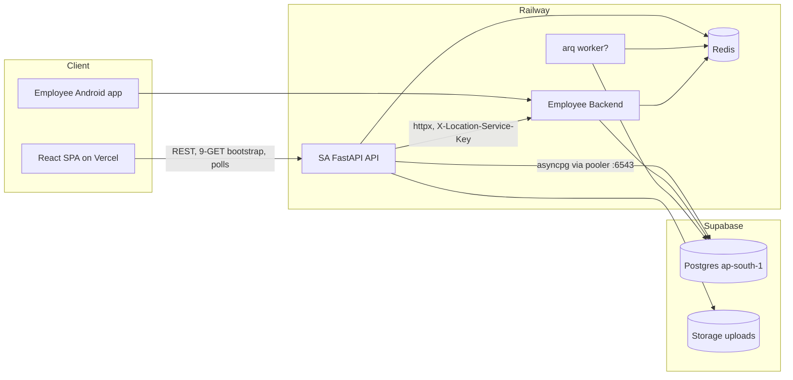

# Architecture Overview (verified against code + live infra)

## Service inventory

| Service | Responsibility | Deployed at | Dependencies | Protocol |
|---|---|---|---|---|
| SA frontend | React 19 SPA, super-admin/property-manager UI | Vercel (`frontend/vercel.json`, GitHub Actions deploy) | SA API only | HTTPS REST |
| SA API (`app.main:app`) | All business REST under `/api/v1` — ~140 routes in 8 routers | Railway service `dc288dfb-…` (Nixpacks, `backend/railway.toml`), region **unverified from repo** | Postgres (Supabase), Redis (optional), EB API, S3/Supabase Storage | HTTP/JSON, asyncpg, redis, httpx |
| Supabase Postgres | Sole persistent store — **shared** with the Employee Backend | `aws-0-ap-south-1.pooler.supabase.com` project `wlxqdsnjiayxeqpejeih`, ap-south-1 (Mumbai) | — | PostgreSQL via pooler :6543 (transaction) and :5432 (session) |
| Redis | Rate-limit counters, arq queue, cache — **optional** | Railway (per docs) — URL only via env; not set in dev `.env` | — | redis protocol |
| Employee Backend (EB) | Employee app API, live locations, attendance writes — separate repo | Railway `employee-api-production-c0e3.up.railway.app` | Same Postgres, same Redis | HTTPS; SA→EB with `X-Location-Service-Key` |
| Supabase Storage (S3) | Task completion images (`uploads` bucket) | `*.storage.supabase.co` ap-south-1 | — | S3 |
| arq worker | Generation ticks in prod (when `RUN_EMBEDDED_SCHEDULER=false`) | Railway (implied; no worker railway.toml in repo — **unverified**) | Redis, Postgres | arq |

## Verified request flow — authenticated read

```
Browser (Vercel CDN)
  → apiFetch: Bearer JWT, 20 s abort timeout, refresh-on-401-once
  → HTTPS → Railway edge (x-railway-edge: hkg1 observed) → uvicorn :$PORT
  → CORSMiddleware → GZip → SecurityHeaders → AccessLog → RequestID
  → HTTPBearer → decode_access_token (JWT, no DB)
  → get_current_user: SELECT users…JOIN companies WHERE users.id=$1   [+1 query]
  → Endpoint → Service → Repository → AsyncSession
  → engine pool (asyncpg) → Supabase pooler :6543 → Postgres
  → *_out() dict serializers → orjson-less JSONResponse → gzip
```

Every list endpoint runs the company-scope join/filter; serializers are
dict-mapped (no pydantic response models), batched — no N+1 observed in
list paths.

## Frontend data flow

`AppContext.loadWorkspace()` fires **9 parallel GETs** (properties, areas,
zones, rooms, dorms, washrooms, employees, tasks?limit=500, maintenance)
on sign-in and session restore. A 20 s `usePolling` refresh re-pulls
rooms/dorms/washrooms/tasks/maintenance (5 GETs/tick). View-level polling:
LiveLocationMap 10 s, TodayTasksView 10 s, AbandonedTodayView 10 s,
TaskReviewPanel 30 s, AttendanceBoard 60 s.

## SA → Employee Backend flow (live locations)

```
LiveLocationMap (10 s poll, no visibility check)
  → GET /api/v1/live-locations
  → auth (1 query) + scope validation (up to 1 more)
  → NEW httpx.AsyncClient per call → DNS+TCP+TLS
  → GET {EB}/admin/live-locations  (X-Location-Service-Key)
  → EB Redis snapshot read (live TTL 120 s)
```
Measured upstream time: ext_ms ≈ 373–571 ms per call (local probe).

## Background loops (embedded scheduler, 60 s tick)

Each tick opens 4 sequential sessions: `RolloverService.expire_due` →
`TemplateService.run_due` → `TaskService.run_due_repetitive` →
`RolloverService.run`; every 15th tick also runs
`reconcile_property` per property (~3–4 sequential queries × every
room/dorm/bed/washroom/fixture).

## Mermaid



## Duplicate implementations observed

- Rollover/expiry logic runs BOTH in SA embedded scheduler and (per
  pg_stat_statements call volumes) an equivalent EB-side tick against the
  shared tables — both sweep `tasks` per minute.
- Resource-blocker checks exist in `resource_state.py` (derive),
  `reconciliation.py` (sweep) and `structure.py` (bulk release) — three
  similar query families hitting `maintenance_tickets`/`tasks` per
  resource.
